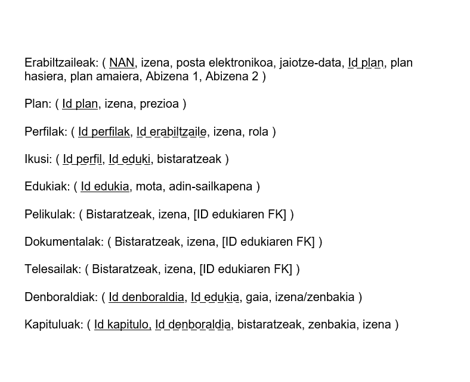

# Sarrera

Lehenik eta behin, enuntziatu bat eman digute eta bertan agertzen den informazioa interpretatu behar izan dugu. Gero, deskribapena egin dugu eta horrekin E/R diagrama osatu dugu. Ondoren, eredu erlazionala sortu dugu eta datu-basea normalizatu dugu. Azkenik, egindako lana Access-en inplementatu dugu.

# 1. Deskribapena

Streaming plataforma batek bere datu-basean erabiltzaileak, perfilak, planak, edukiak eta bistaratzeak kudeatu nahi ditu.

Erabiltzaile bakoitzak NAN, Posta elektronikoa, izena, 2 abizenak eta jaiotze-data ditu. Erabiltzaileek planak kontratatu ditzakete, eta plan bakoitzak bere identifikazio zenbakia, izena eta prezioa ditu. Erabiltzaile batek plan bat kontratatzen du eta kontratazio bakoitzean planaren hasiera eta amaiera datak gordetzen dira. 

Erabiltzaile bakoitzak perfil bat edo gehiago izan ditzake baina perfil bat erabiltzaile batena da. Perfilak, ID perfilak, izena eta rola izango ditu. Plataforman hainbat eduki daude ikusgai, eta eduki bakoitzari buruz identifikazio zenbakia, mota eta adin sailkapena gordetzen da. Profil bakoitzak hainbat eduki ikus ditzake, eta eduki bera hainbat profilek ikus dezakete. Ikusitako edukien eta profilen arteko erlazioa gordetzeko, ikusitako eduki bakoitzaren biztaratzeak ere erregistratzen dira. 

Edukiak hiru motatakoak izan daitezke: pelikulak, telesailak eta dokumentalak. Pelikulei buruz, izena eta pelikulen bistaratzeak gordetzen dira. Telesail bakoitzari buruz ere, izena eta bistaratze telesailak gordetzen dira. Dokumental bakoitzari buruz, izena eta bistaratze dokumentalak erregistratzen dira. 

Telesail bakoitzak denboraldi bat edo gehiago izan ditzake, eta denboraldi bakoitza telesail bakar bati dagokio. Denboraldiei buruz, identifikazio zenbakia, gaia eta izen-zenbakia gordetzen da. 

Bukatzeko denboraldi bakoitzak kapitulu bat edo gehiago ditu, eta kapitulu bakoitza denboraldi bakar batekoa da. Kapitulu bakoitzari buruz, Id-kapituloa, izena, zenbakia eta bistaratzeak gordetzen dira. Kapituluak dagokion denboraldiarekin lotuta erregistratzen dira, denboraldi bakoitzeko kapituluak identifikatu eta antolatu ahal izateko.

# 2. ER Diagrama

# 3. Eredu erlazionala
ER diagrama amaitu eta gero, datu-basearen eredu erlazionala egin dugu. 

# 4. Normalizazioa
Ondoren, datu basearen normalizazioa egin dugu. Hiru forma normalak ( 1FN, 2FN eta 3FN ) aplikatuz.

Normalizazioa eginda ↓

[Sakatu hemen](normalizazioa/Normalizazioa.pdf)

# 5. Datu basea Access-en implementatu 
Azkenik, datu-basea Access-en inplementatu dugu. Taulak eta haien arteko erlazioak sortuz. Horrela, informazioa modu egituratuan gorde, kontsultatu eta eguneratzeko aukera izango dugu.

