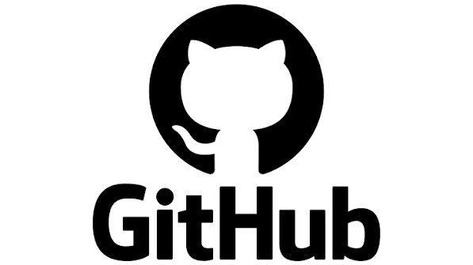
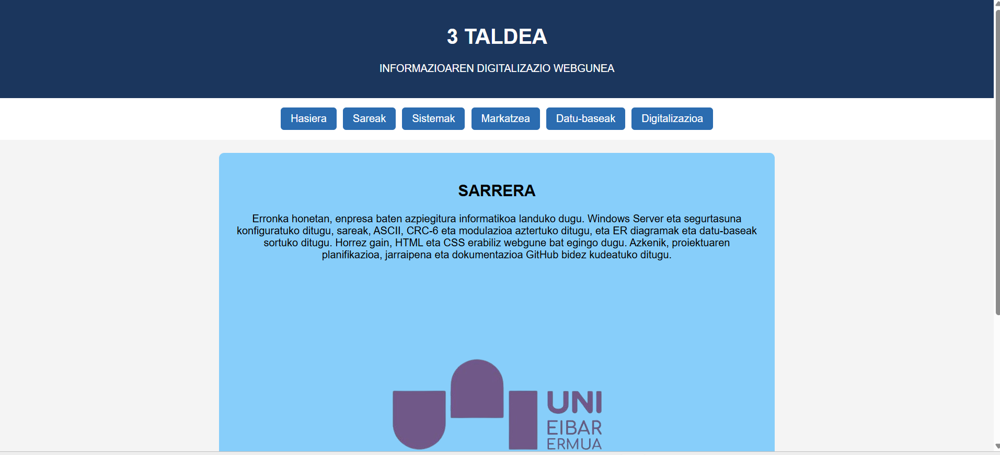
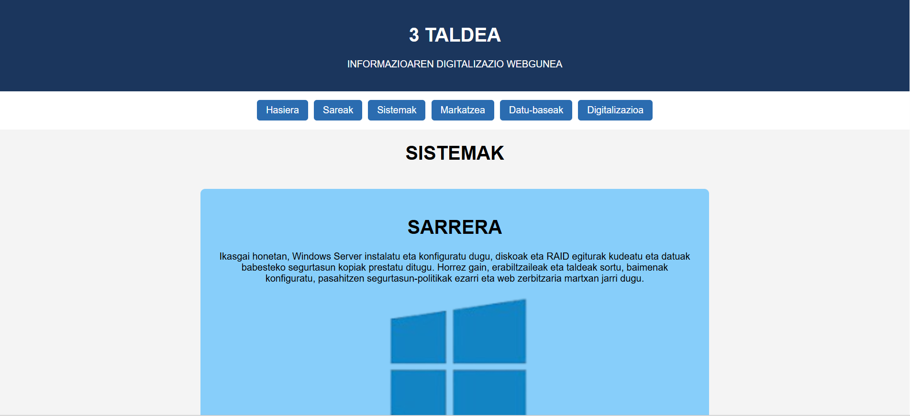

## Sarrera

Proiektu honetan HTML eta CSS erabiliz webgune bat sortu dugu. Horretarako izenburuak, zerrendak, estekak eta irudiak gehitu ditugu baita menu bat eta footer bat ere. Gainera CSS estiloak aplikatu ditugu webgunearen diseinua hobetzeko eta dokumentazioa GitHub-en egin dugu MD erabiliz.

##  1. Erabilitako programak 

- **HTML:** Testuak, izenburuak, irudiak eta estekak sortzeko.
- **CSS:** Koloreak, tamainak, botoiak eta elementuen kokapena aldatzeko.
- **Visual Studio Code:** Kodea idazteko eta editatzeko.
 
- **GitHub:** Fitxategiak gordetzeko eta lana antolatzeko.
  

##  2. Karpeta eta fitxategien egitura 

- **css/**: styleserronka.css fitxategia gordetzen du; webgunearen diseinua definitzen du.
- **doc/img/**: Irudiak gaika antolatzen ditu.
- **HTML fitxategiak:** Webguneko sei orriak dira.
- **Markdown fitxategiak (.md):** Dokumentazioa idazteko erabiltzen dira.
- **_config.yml**: GitHub Pages edo Jekyll erabiltzen bada, konfigurazioa zehazten du.

## 3. HTML etiketak

- **!DOCTYPE html:** HTML5 formatua adierazten du.
- **html lang="eu":** Dokumentuaren hizkuntza euskara dela adierazten du.
- **head:** Orriaren konfigurazioa gordetzen du.
- **title:** Nabigatzaileko fitxaren izena zehazten du.
- **link:** HTMLa CSS fitxategiarekin lotzen du.
- **body:** Webguneko eduki guztia biltzen du.
- **header:** Goiburua sortzen du.
- **nav:** Nabigazio-menua sortzen du.
- **a href="sareak.html">:** Beste HTML orri batera joateko esteka sortzen du.
- **main:** Eduki nagusia biltzen du.
- **h1, h2 eta h3:** Izenburuak sortzen dituzte.
- **p:** Paragrafoak sortzen ditu.
- **img src="..." alt="...":** Irudiak txertatzen ditu; src kokapena da eta alt deskribapena.
- **footer:** Orriaren beheko zatia sortzen du.

## 4. CSS propietateak

- **margin:** Kanpoko tartea ezartzen du.
- **padding:** Barruko tartea ezartzen du.
- **background-color:** Atzeko planoaren kolorea aldatzen du.
- **color:** Testuaren kolorea aldatzen du.
- **font-family:** Letra mota zehazten du.
- **text-align:** Testua lerrokatzen du.
- **display: flex:** Elementuak malgutasunez antolatzen ditu.
- **flex-direction: colum:** Elementuak bertikalean kokatzen ditu.
- **justify-content: center:** Elementuak erdian kokatzen ditu.
- **gap:** Elementuen arteko tartea ezartzen du.
- **width eta max-width:** Zabalera zehazten eta mugatzen dute.
- **height: auto:** Irudiaren proportzioak mantentzen ditu.
- **border-radius:** Ertzak biribiltzen ditu.
- **min-height: 100vh:** Gutxieneko altuera pantailaren altuerara egokitzen du.

## 5. Webgunearen diseinua eta nabigazioa 

Webguneko orri guztiek diseinu antzekoa dute. Goiburuak taldearen izena erakusten du, menuak beste orrietara sartzeko botoiak ditu, eta eduki nagusian testuak eta irudiak agertzen dira.

href atributuaren bidez, botoi bakoitza dagokion HTML fitxategiarekin lotzen dugu. CSSren bidez, botoien kolorea, testuaren itxura eta edukien kokapena zehazten ditugu.

Webgunea egiaztatzeko, orriak ireki ditugu, menuaren estekak probatu ditugu eta irudiak zein estiloak behar bezala agertzen direla egiaztatu dugu.

## 6. Webgunearen argazkiak

<<<<<<< HEAD
## WEB ORRIALDERAKO SARBIDEA
[🌐 Abrir página web]
=======
## 7. Web orrialderako sarbidea 
[Web 3 TALDEA](http://127.0.0.1:5500/index.html)
>>>>>>> 4f992e05a5893e6ab28bc5ac39f47e38039d4aa2

