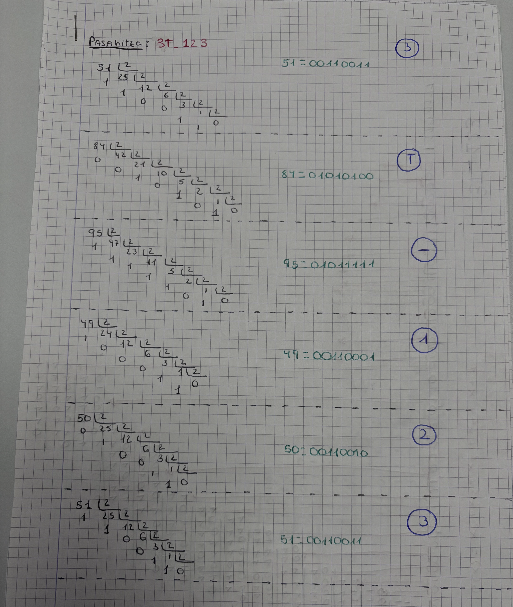
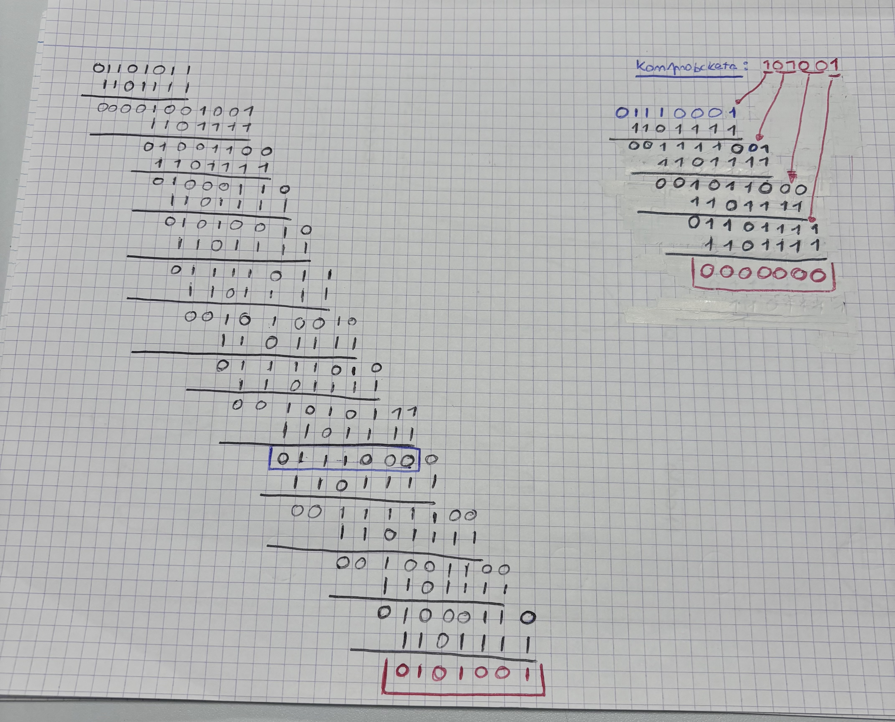
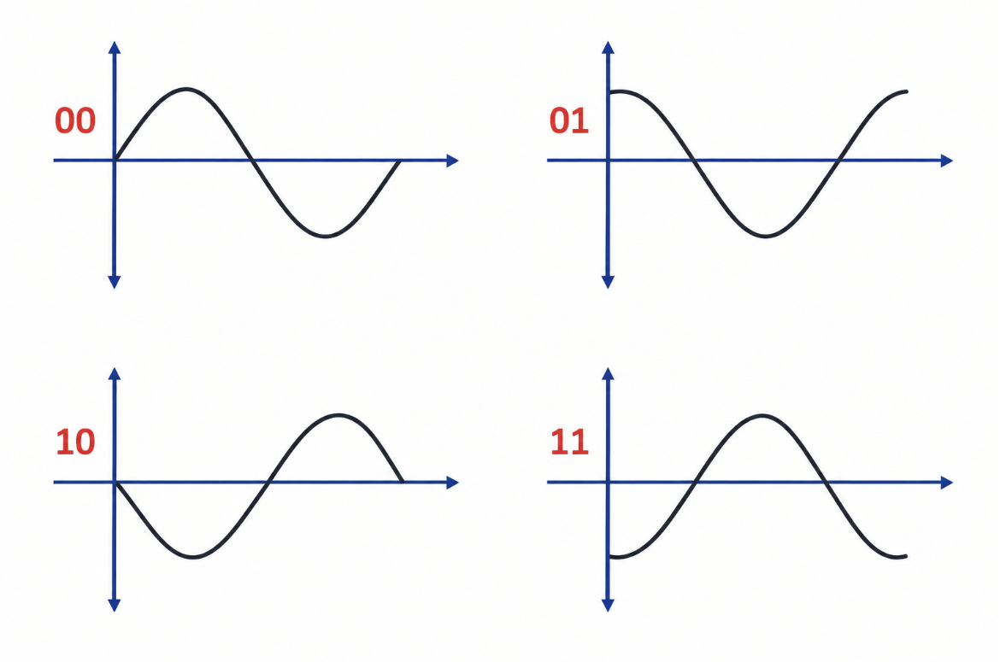
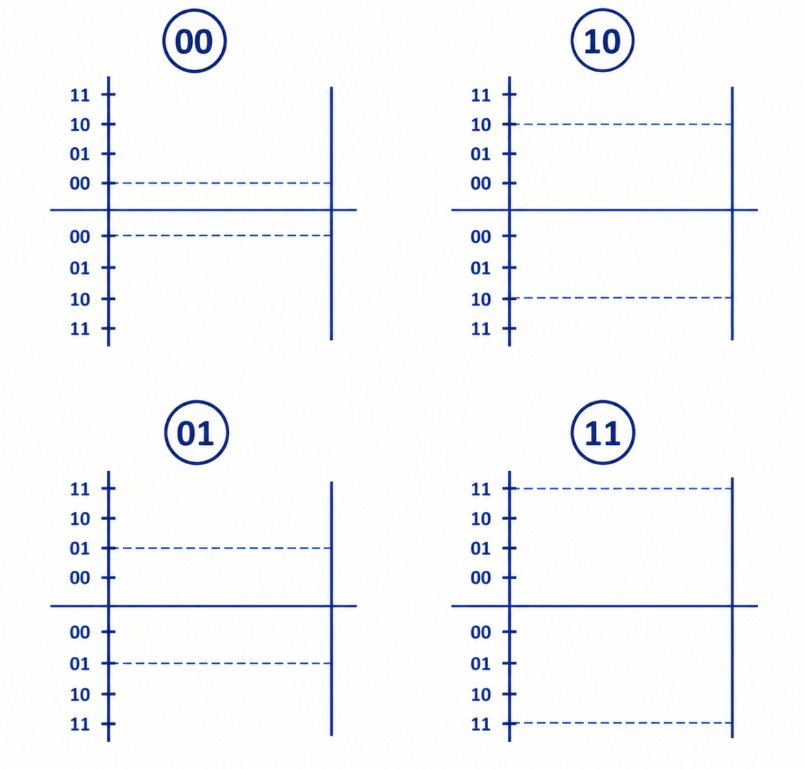
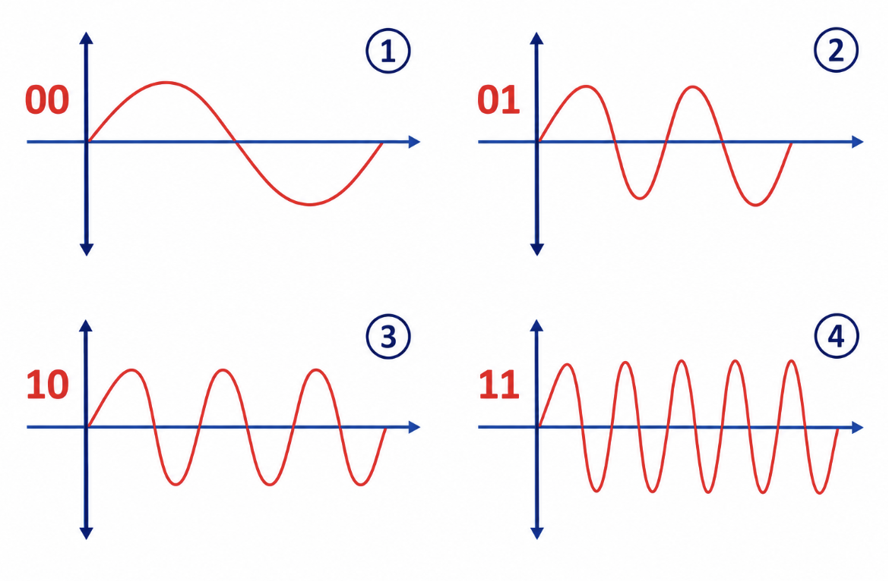
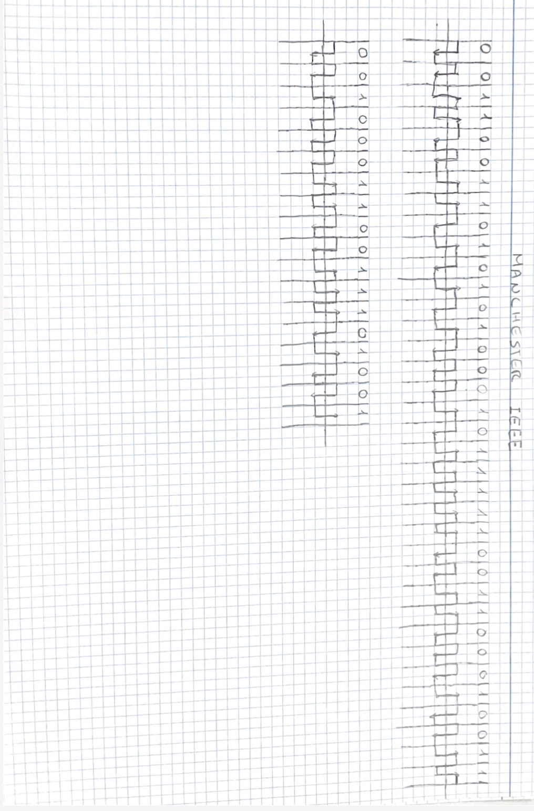
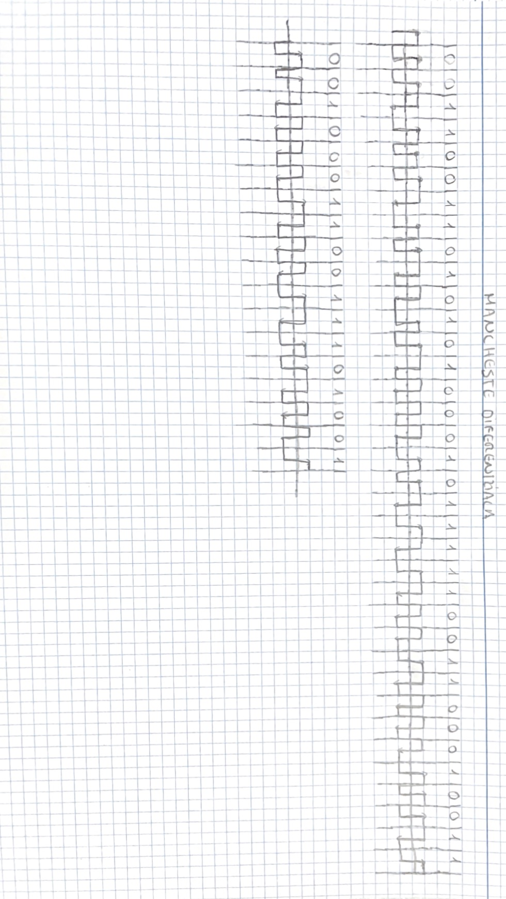
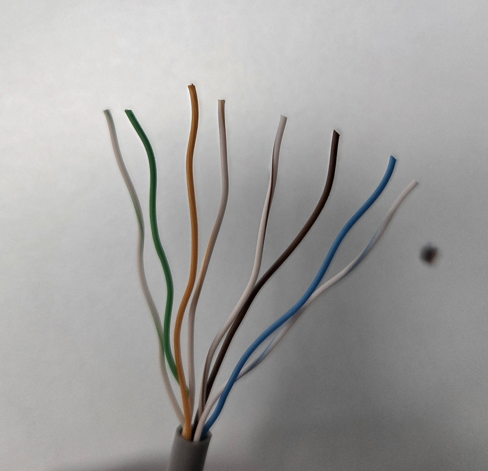

# PASAHITZA ASCII-RA 
Lehenik eta behin, zerbitzarian erabiltzeko pasahitz bat erabaki dugu: 3T_123. Pasahitz hau ASCII bidez karaktere bakoitzari dagokion zenbakia adierazten da. Horrela pasahitzaren karaktere bakoitza zenbaki batez irudika daiteke.         

ASCII :

3 = 51

T = 84

_ = 95

1 = 49

2 = 50

3 = 51

Ondoren, zenbaki bakoitza bitarrera pasatu dugu, CRC-a egiteko. Horretarako zenbaki bakoitza zati 2 egin dugu, hondarra lortu arte. Gero, hondarrak behetik gora irakurri ditugu, eta 8 bit-eko zenbaki bat lortu dugu. 

## ASCII ARIKETA 

# CRC
CRC-a egiteko ASCII bidez lortutako 6 karaktereak bitar sistemara pasatu ditugu eta 8 biteko zenbaki bakoitza elkartuz 48 biteko bit-kate bat osatu dugu. Ondoren, 6 zero gehitu dizkiogu CRC-6 delako.
Erabili dugun polinomioa hau da: $(X^6+X^5+X^3+X^2+X+1)$

Polinomio hori bitar sistemara pasatuta, 110111 lortzen da. Ondoren, gure kasuan lehenengo bi bitak 0 direnez hurrengo posiziora pasatuko gara bit-kate horren hurrengo 7 bitak hartuz eta XOR eragiketa egingo dugu. Horretarako kontuan izan behar da : 

0+0 = 0

1+0 = 1

0+1 = 1

1+1 = 0

Emaitza lortu ondoren hurrengo bitak jaitsi ditugu eta prozesu bera errepikatu dugu bit guztiak erabili arte. Azkenik lortutako hondarra 6 bitekoa (101001) izan da, eta hori da pasahitzaren CRC-a da.

Pasahitza ondo dagoen egiaztatzeko konprobaketa egin dugu. Hasierako bit-kateari 6 zero gehitu beharrean, lortutako emaitza sartu dugu. Ondoren, berriro zatiketa bitarra egin dugu polinomio berarekin. Hondarra (000000) denez, egiaztapena zuzena da eta ez da errorik detektatzen. 

## CRC ARIKETA

# PSK(2),ASK(2),FSK(2)
PSK(2),ASK(2) eta FSK(2) egin baino lehen guk aukeratutako pasahitza bitarrera aldatu dugu, behin bitarrean izan dugunean zatiketa egin dugu CRC6 formularekin $(X^6+X^5+X^3+X^2+X+1)$

Zatiketaren hondarra lortu eta gero (PSK2,ASK2,FSK2) grafikoak egin ditugu.
Grafikoak egiteko lortu ditugun 54 bit-ak sei-naka banatu ditugu.

## PSK2 - MODULAZIO ARAUAK
* PSK(2) norabidea adierazten digu, baita bitak binaka multzokatzen dira.
* 4 hasiera mota desberdin daude: (00,01,10,11.)
- 00 hasiera: 0-tik hasten da eta gora joaten da.

- 01 hasiera: Goitik hasten da ASK(2) definitzen duen lekutik.

- 10 hasiera: 0-tik hasten da eta behera joaten da.

- 11 hasiera: Betikan hasten ASK(2) definitzen duen lekutik.

## ASK2 - MODULAZIO ARAUAK
* ASK(2) altuera adierazten digu, baita bitak binaka multzokatzen dira.
* 4 altura mota desberdin daude: (00,01,10,11)
* Altuerak marrazteko lehenik taula bat marraztu behar da eta bertan datuak ipini.
argazkia

## FSK(2) - MODULAZIO ARAUAK
* FSK(2) uhin kopurua adierazten digu, baita bitak binaka multzokatzen dira.
* 4 uhin mota daude: (00,01,10,11)
- 00 mota: uhin bat bakarrik bidaltzen du.

- 01 mota: 2 uhin bidaltzen ditu.

- 10 mota: 3 uhin bidaltzen ditu.

- 11 mota: 4 uhin bidaltzen ditu.

## PSK(2),ASK(2),FSK(2) ARIKETA
,ASK(2),FSK(2).png)

# MANCHESTER IEEE
* Manchester IEEE-k bitak adierazten ditu eta hartzaileari datuak noiz irakurri behar dituen jakiten laguntzen dio.

* Manchester IEEE egiteko lehenik tarte bakoitzari dagokion geziak irudikatu ditugu.
- 0: Gezia behera
- 1: Gezia gora
argazkia
* Prozedura: Zatiketa egin eta gero ateratako 54 bitak ipini ditugu lerro batean, ondoren bakoitzari tarte bat laga diogu. Tartea hutzi eta gero zenbaki bakoitzari dagokion gezia ipini diogu, geziak ipini eta gero geziak lotzen hasi gara. Geziak lotzeko dagokion araua jarraitu dugu. ( Araua: igo baino lehen jaitsi behar da, eta jaitsi baino lehen igo behar da.)
## MANCHESTER IEEE ARIKETA

# MANCHESTER DIFERENTZIALA
* Manchester Diferentzialak bitak adierazten ditu, eta 0 eta 1 bereizteko bitaren hasieran aldaketarik dagoen ala ez begiratzen da.
- 0: Gezia berdin mantentzen da
- 1: Geziaren noranzkoa aldatzen da

* Prozedura: Zatiketa egin eta gero ateratako 54 bitak ipini ditugu lerro batean, ondoren bakoitzari tarte bat laga diogu. Tartea hutzi eta gero zenbaki bakoitzari dagokion gezia ipini diogu, geziak ipini eta gero geziak lotzen hasi gara. Geziak lotzeko dagokion araua jarraitu dugu. ( Araua: igo baino lehen jaitsi behar da, eta jaitsi baino lehen igo behar da.)
# MANCHESTER DIFERENTZIAL ARIKETA

# PATCH PANELA ETA KABLEA

## KABLEA
* Prozedura: Hasteko, kable bat zuritu dugu bi aldeetatik.

Jarraian alde bat jarri behar izan dugu RJ45 B-n, bertan jarri dugu or ipintzen duen kolore-ordenan. Erremientarekin koloreen arabera ordenatu ondoren, kablea katigatuko dugu, eta gainerakoa moztu egingo dugu, kanpotik geratzen ez dena gera ez dadin.
## RJ45 B KONEKTOREA EGINDA

## PATCH PANELA
* Prozedura: Patch panela egiteko, kable zurituaren beste zatia hartu dugu. Patch panelean jartzen duzun lekuaren arabera, koloreen ordena aldatu egiten da. Gure lekuan eskura jartzen duen ordenan jarri dugu eta gero erremintarekin RJ45 B-arekin egiten den gauza bera egin dugu. Kablea ondo lotu, eta gainerazkoa moztu. Ondo doala egiarazteko, sareko kable bat hartu dugu, eta alde batean rj45 b-n entxufatuko dugu, eta bestea testerrean. Argi guztiak pizten badira, prozezua ondo eginda dagoela da.
## PATCH PANELA EGINDA

